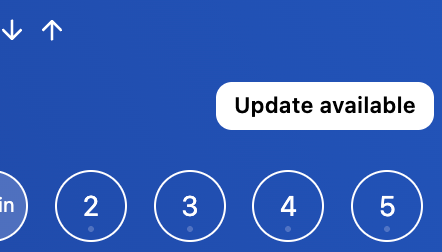
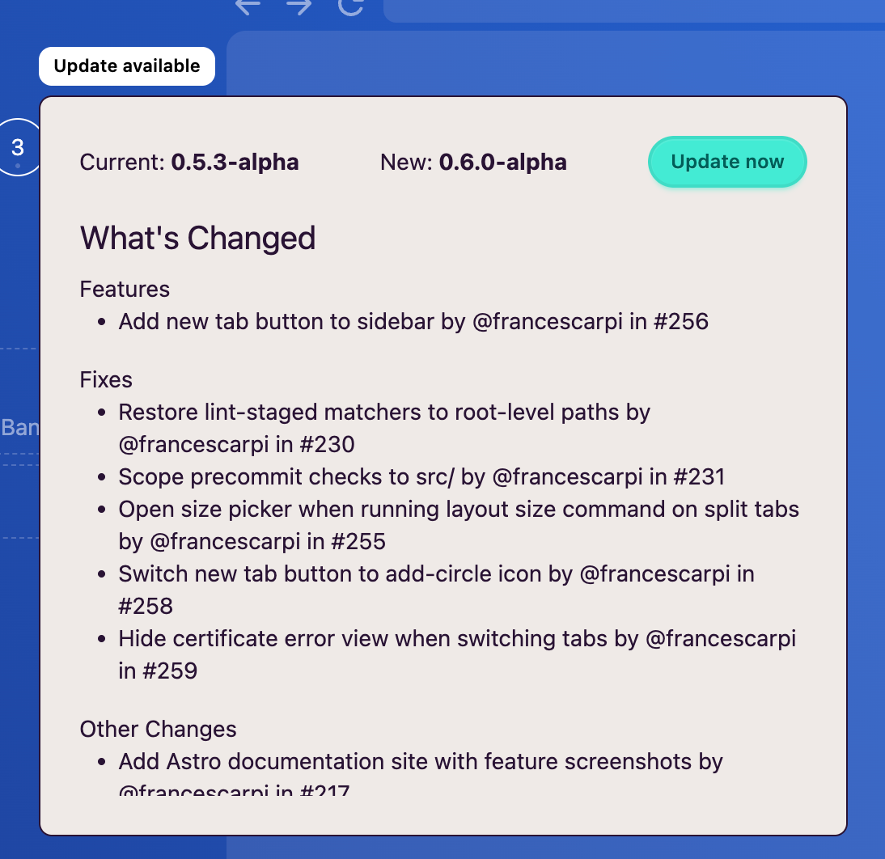
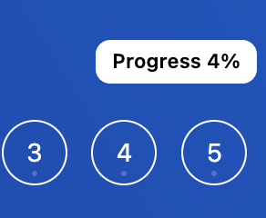

When a new update is available, you'll see a button above the desktops.

You can also use the **Check for Updates** command from the command palette to check manually while AwesomeB is running. On macOS, the same action is available in the app menu (**AwesomeB** → **Check for Updates…**). The command only checks for updates; it does not download or install them.

When you click the button, a modal will appear with the release notes.

If you've skipped several releases, the modal lists the notes for **every version** between the one you're running and the newest one, newest first. The header tells you how many versions are being skipped.

Each entry shows only the description of the change. Author handles and pull request links are removed so the list stays readable.

:::note
It's always recommended to install the latest version to have the most stable and secure version possible.
:::

Click **Update now** to download it. The download progress will appear in the same place:

When the download finishes, you'll see the **Quit & Install** button to proceed with the installation.

