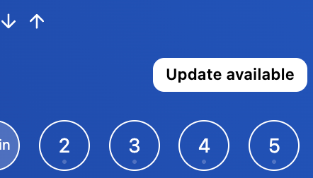
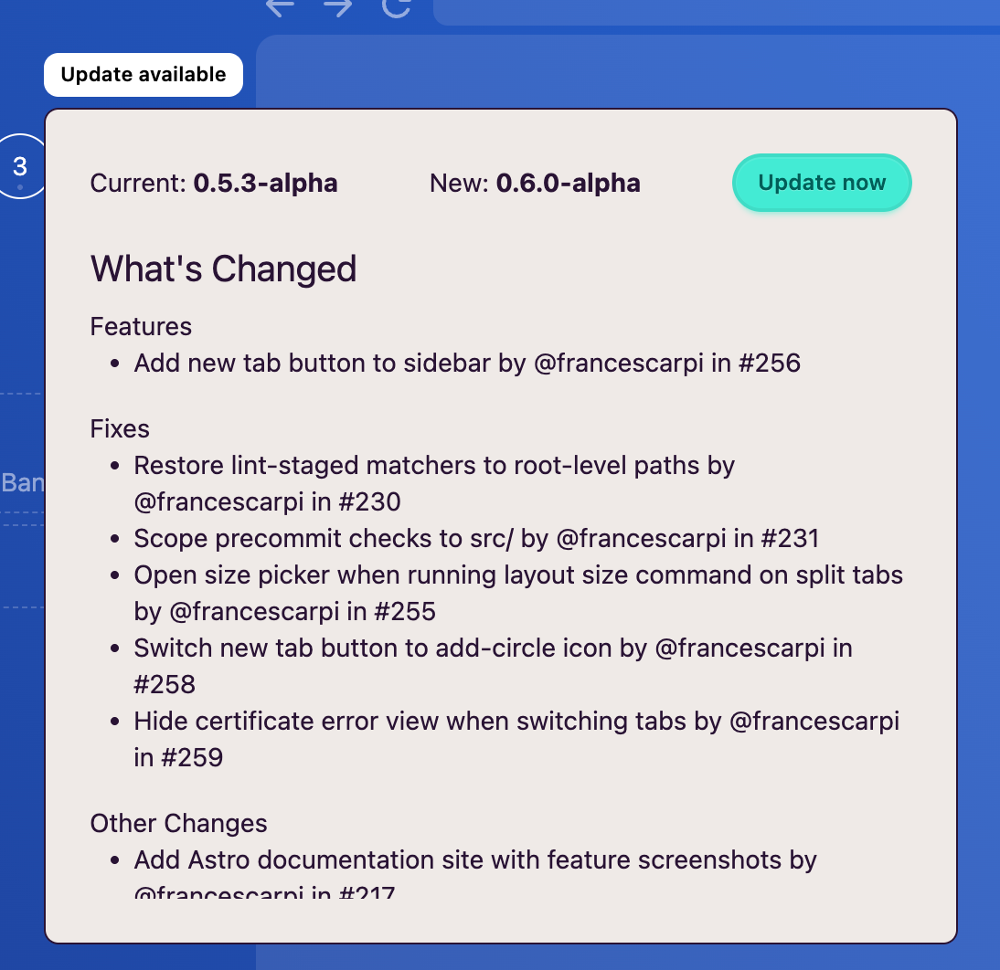
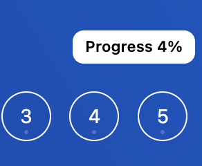

Quan hi hagi una nova actualització disponible, la veuràs indicada amb un botó sobre els escriptoris.

També podràs utilitzar el comandament **Comprova si hi ha actualitzacions** des de la paleta de comandaments per a comprovar-ho manualment mentre AwesomeB està obert. A macOS, la mateixa acció està disponible al menú de l'aplicació (**AwesomeB** → **Comprova si hi ha actualitzacions…**). El comandament només comprova si hi ha actualitzacions; no les descarrega ni les instal·la.

Al fer clic sobre el botó, t'apareixerà un modal amb les novetats de la versió.

Si t'has saltat diverses versions, el modal mostra les novetats de **totes les versions** entre la que fas servir i la més recent, de la més recent a la més antiga. La capçalera t'indica quantes versions s'ometen.

Cada entrada mostra només la descripció del canvi. Els noms d'autor i els enllaços als pull requests s'eliminen perquè la llista continuï sent llegible.

:::note
Sempre és recomanable instal·lar l'última versió per a tenir la versió més estable i segura possible.
:::

Fes clic a **Update now** per a descarregar-la. El progrés de la descàrrega el veuràs també al mateix lloc:

Quan hagi acabat la descàrrega, veuràs el botó de **Quit & Install** per a procedir amb la instal·lació.

