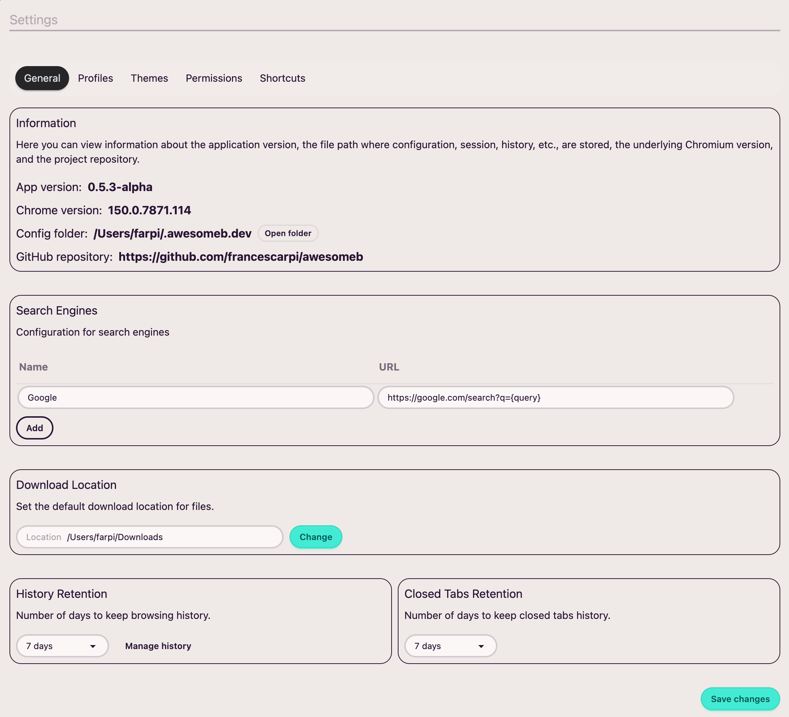

import FeatureAccess from '../../../../components/FeatureAccess.astro'

<FeatureAccess entity="configuració general" menu="app.preferences" shortcut="preferences" />

Aquí hi trobaràs diferents apartats de configuració genèrica.

## Informació

Hi trobaràs la versió de l'aplicació, la de Chrome, la ruta de la carpeta de configuració d'**AwesomeB** i la URL del repositori.

:::note
Tingues en compte que tots els fitxers de configuració (sessions, historial, marcadors, etc.) estan en text pla. Això vol dir que pots fer-ne còpies de seguretat amb el teu sistema de control de versions.
:::

## Motors de cerca

Com has vist a l'apartat de [primeres passes](/ca/firststeps), cal configurar un primer motor de cerca en iniciar el navegador per primera vegada.

Des d'aquí podràs afegir-ne més, editar-los o esborrar-los.

## Carpeta de descàrregues

Permet configurar la carpeta on el navegador hi deixarà les descàrregues.

## Idoma

Permet indicar l'idioma de l'aplicació. Tingues en compte que al canviar-lo hauràs de reinciar en navegador.

## Retenció de l'historial

Permet indicar durant quants dies vols que es guardi l'historial de navegació. També hi ha un enllaç a la vista de l'historial.

## Retenció de les pestanyes tancades

Quan es tanca una pestanya, **AwesomeB** ho fa de forma *virtual*. En realitat, roman allà de forma oculta durant uns dies (per si vols recuperar-la). Des d'aquí pots indicar durant quants dies vols que es mantinguin les pestanyes tancades.

## Bloquejador d'anuncis

**AwesomeB** bloqueja anuncis i rastrejadors de sèrie, utilitzant llistes de filtres mantingudes per la comunitat. L'interruptor et permet desactivar el bloqueig si prefereixes veure els anuncis.

El bloqueig s'aplica al perfil per defecte i a qualsevol perfil personalitzat que creïs. Les finestres privades mai no es filtren.

:::note
Les llistes de filtres es descarreguen la primera vegada que inicies el navegador i després es desen al disc, de manera que els inicis següents funcionen sense connexió. Si reinicies **AwesomeB** després de canviar l'interruptor, el canvi s'aplicarà a tot arreu.
:::
