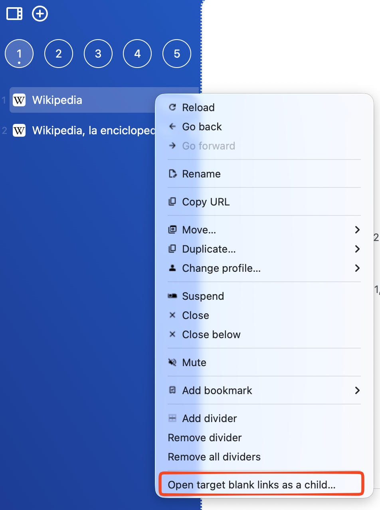
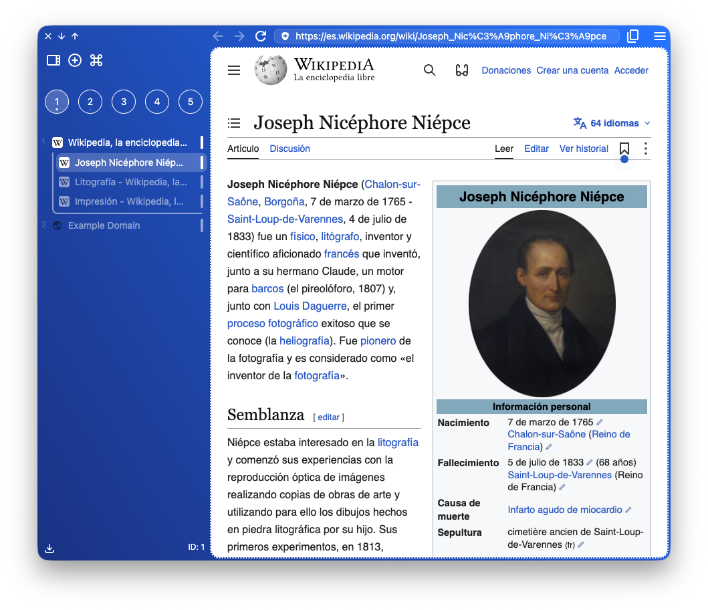
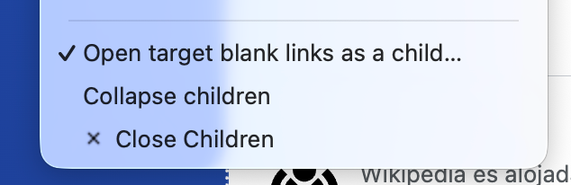
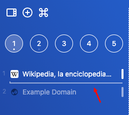

---

title: Pestanyes filles
---

import { getMenuItems } from '../../../../../scripts/i18n';
export const menu = await getMenuItems('ca', 'contextTab.openTargetBlankAsChild')
export const move = await getMenuItems('ca', 'contextTab.move')

Imagina't el següent escenari.

Al *sidebar* hi tens tres pestanyes: Jira, Pestanya 2, Pestanya 3. Jira obre tots els tiquets com a `target="_blank"`. Això vol dir que es crearan noves pestanyes al final, després de la Pestanya 3.

Això és molt incòmode perquè queden pestanyes desorganitzades i és per aquest motiu que existeix la següent funcionalitat.

Obre el menú contextual i selecciona l'opció **{menu[0]}**.

A partir d'ara, tots els llocs web que s'obrin des d'aquesta pestanya quedaran com a fills.

Això et permet moure el pare amunt o avall mantenint els fills relacionats.

A banda, també a través del menú contextual, tindràs l'opció de tancar tots els fills o de col·lapsar-los.

Si estan col·lapsats, ho veuràs amb un claudet al sidebar, dibuixat al voltant dels fills:

El claudet està format per dues línies: una vertical a l'esquerra i una horitzontal a sota, unides per una cantonada arrodonida. La línia horitzontal arriba fins al marge dret del sidebar, i la cantonada fa servir el mateix arrodoniment que les pestanyes, de manera que el claudet es llegeix com una sola forma juntament amb el bloc de pestanyes. Fes clic a qualsevol part per tornar a expandir els fills sense passar pel menú contextual. Quan els fills estan expandits, el mateix claudet els envolta i en fer-hi clic es tornen a col·lapsar.

En passar el cursor per sobre del claudet, es torna totalment opac i una mica més gruixut, així l'acció només apareix quan la necessites.

Si vols desvincular una pestanya filla del seu pare i convertir-la en un contenidor de pestanyes normal de nivell superior, obre el menú contextual sobre la pestanya filla, tria **{move[0]}** i tot seguit *Mou al nivell superior*. La pestanya filla conserva les seves pròpies pestanyes i qualsevol filla seva.

També pots arrossegar una pestanya i deixar-la anar sobre una pestanya que tingui aquesta opció activada per convertir-la en una filla seva. Consulta [moure una pestanya](/ca/tabs/move/#arrossegar-i-deixar-anar).
