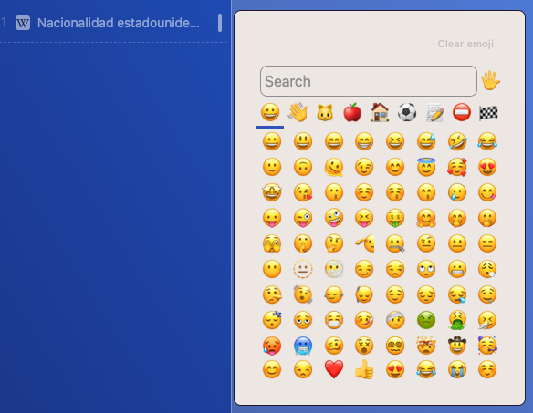
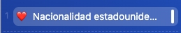
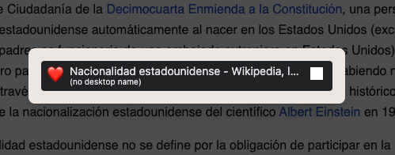
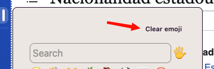

import FeatureAccess from '../../../../components/FeatureAccess.astro'

Un emoji és un **marcador** que pots posar a una pestanya per distingir-la de les altres. Ocupa el lloc del favicon, així que l'emoji és el que veuràs a la barra lateral.

## Posar un emoji

<FeatureAccess entity="posar un emoji a una pestanya" contextMenu="contextTab.setEmoji" />

Obre el **menú contextual** d'una pestanya i fes clic a **Estableix un emoji...**. S'obre un panell al costat de la pestanya amb una llista d'emojis que pots recórrer per categories o cercar per nom.

Fes clic a l'emoji que vulgis i s'assigna a la pestanya. El panell es tanca sol.

## Veure l'emoji d'una pestanya

Cada pestanya mostra el seu emoji a la barra lateral, on seria el favicon.

L'emoji també apareix al selector de pestanyes, així que pots localitzar una pestanya sense llegir tota la llista.

## Treure l'emoji

Obre altre cop el panell de **Estableix un emoji...** i fes clic a **Esborra l'emoji**. La pestanya torna a mostrar el seu favicon.

:::note
El botó **Esborra l'emoji** només és actiu quan la pestanya ja té un emoji.
:::

## Emojis i sessions

L'emoji es desa amb la sessió, així que torna quan la restaures. Si dupliques una pestanya, la còpia rep el mateix emoji.

:::note
Els emojis es dibuixen amb la font d'emojis del teu sistema operatiu. Poden tenir un aspecte diferent segons l'equip que facis servir.
:::
