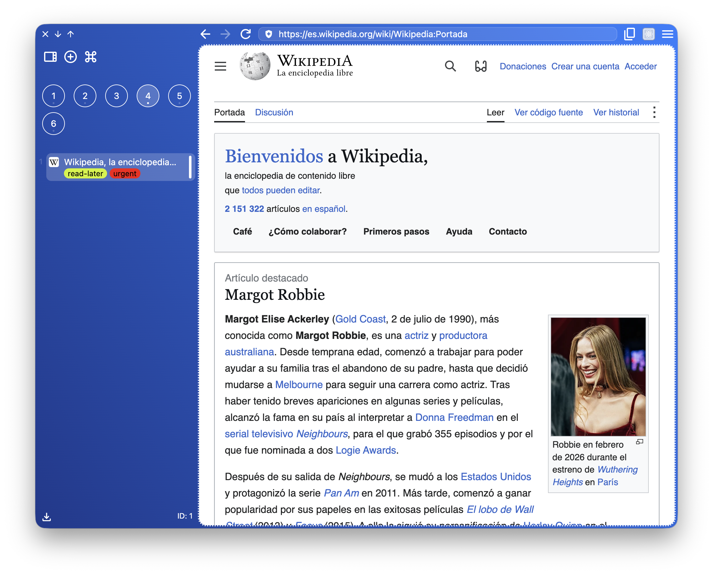
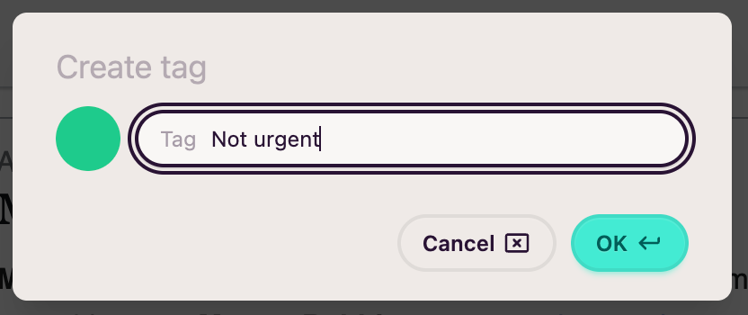
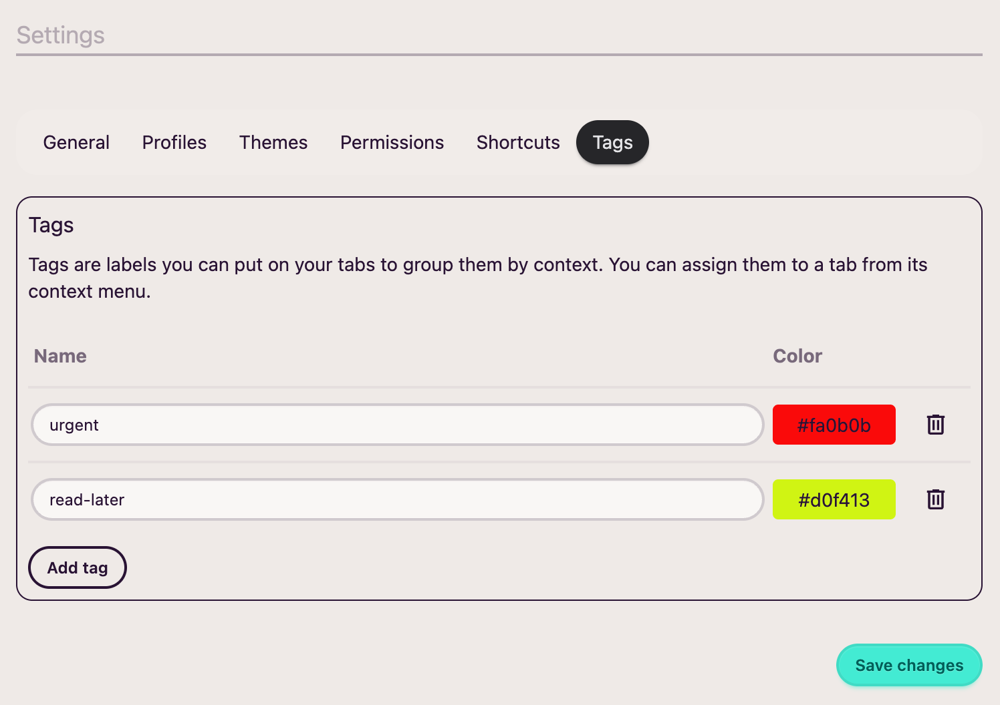

import FeatureAccess from '../../../../components/FeatureAccess.astro'

Les etiquetes són **etiquetes** que pots posar a les pestanyes per agrupar-les per context. Una etiqueta té un nom i un color, i una pestanya pot tenir tantes etiquetes com vulguis.

## Crear una etiqueta

<FeatureAccess entity="crear una etiqueta" contextMenu="contextTab.createTag" />

Obre el **menú contextual** d'una pestanya i ves a **Etiquetes → Crear etiqueta**. Pots triar el color i escriure el nom de l'etiqueta.

El nom que escriguis es converteix en un nom curt, format per lletres minúscules i guions, de fins a deu caràcters. En necessita almenys tres.

L'etiqueta es crea i s'assigna a la pestanya des de la qual has obert el menú.

## Veure les etiquetes d'una pestanya

Cada pestanya mostra les seves etiquetes a la barra lateral, sota el seu títol. Cada una és una etiqueta amb el nom del tag sobre el color del tag.

## Assignar i treure una etiqueta

Obre el **menú contextual** d'una pestanya i ves a **Etiquetes**. Allà hi ha totes les etiquetes que tens, i les que la pestanya ja té apareixen marcades.

<FeatureAccess entity="assignar una etiqueta a una pestanya" contextMenu="contextTab.tags" />

Fes clic en una d'elles per assignar l'etiqueta a la pestanya, o per treure-la si la pestanya ja la tenia.

## Gestionar les teves etiquetes

Pots afegir, reanomenar, canviar el color i eliminar les teves etiquetes des de l'apartat **Etiquetes** de la configuració.

Des d'aquest apartat pots:

* Afegir una etiqueta nova.
* Canviar el nom d'una etiqueta. El nom es converteix en un nom curt, igual que quan crees una etiqueta.
* Canviar el color d'una etiqueta.
* Eliminar una etiqueta.

:::note
Eliminar una etiqueta també la treu de totes les pestanyes que la tenien.
:::
