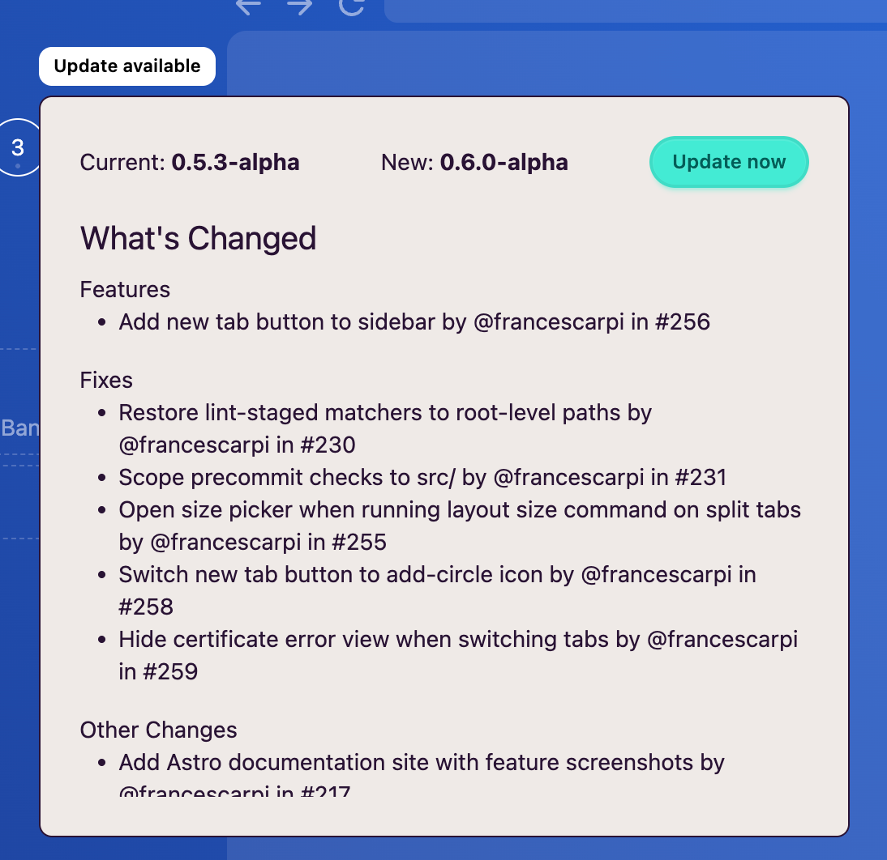
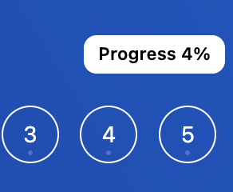

Cuando haya una nueva actualización disponible, la verás indicada con un botón sobre los escritorios.

También podrás usar el comando **Buscar actualizaciones** desde la paleta de comandos para comprobarlo manualmente mientras AwesomeB está abierto. En macOS, la misma acción está disponible en el menú de la aplicación (**AwesomeB** → **Buscar actualizaciones…**). El comando solo comprueba si hay actualizaciones; no las descarga ni las instala.

Al hacer clic sobre el botón, te aparecerá un modal con las novedades de la versión.

Si te has saltado varias versiones, el modal muestra las novedades de **todas las versiones** entre la que estás usando y la más reciente, de la más reciente a la más antigua. La cabecera te indica cuántas versiones se están omitiendo.

Cada entrada muestra solo la descripción del cambio. Se eliminan los nombres de autor y los enlaces a los pull requests para que la lista siga siendo legible.

:::note
Siempre es recomendable instalar la última versión para tener la versión más estable y segura posible.
:::

Haz clic en **Update now** para descargarla. El progreso de la descarga lo verás también en el mismo lugar:

Cuando haya terminado la descarga, verás el botón de **Quit & Install** para proceder con la instalación.

