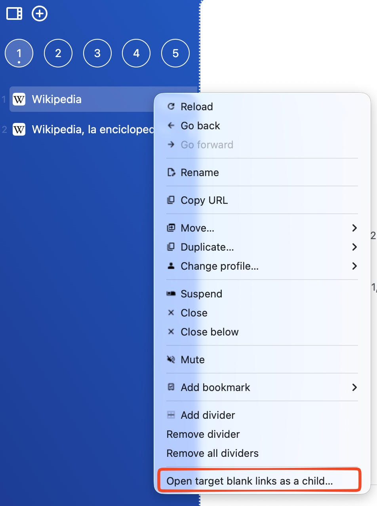
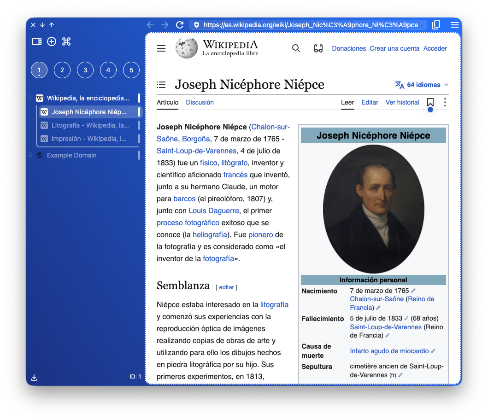
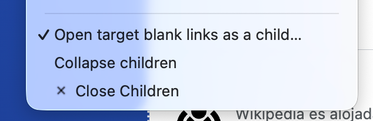
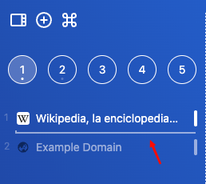

import { getMenuItems } from '../../../../../scripts/i18n';
export const menu = await getMenuItems('es', 'contextTab.openTargetBlankAsChild')
export const move = await getMenuItems('es', 'contextTab.move')

Imagina el siguiente escenario.

En el *sidebar* tienes tres pestañas: Jira, Pestaña 2, Pestaña 3. Jira abre todos los tickets como `target="_blank"`. Esto significa que se crearán nuevas pestañas al final, después de la Pestaña 3.

Esto es muy incómodo porque quedan pestañas desorganizadas y por eso existe la siguiente funcionalidad.

Abre el menú contextual y selecciona la opción **{menu[0]}**.

A partir de ahora, todos los sitios web que se abran desde esta pestaña quedarán como hijas.

Esto te permite mover el padre arriba o abajo manteniendo las hijas relacionadas.

Además, también a través del menú contextual, tendrás la opción de cerrar todas las hijas o de colapsarlas.

Si están colapsadas, lo verás con un enlace de texto en el sidebar que te dice cuántas pestañas están ocultas:

Haz clic en ese enlace para volver a expandir las hijas sin pasar por el menú contextual. El enlace se mantiene discreto en reposo y solo se vuelve totalmente opaco al pasar el cursor por encima, así la acción aparece cuando la necesitas.

Cuando las hijas están expandidas, las rodea un corchete. Está formado por dos líneas: una vertical a la izquierda y otra horizontal abajo, unidas por una esquina redondeada. La línea horizontal llega hasta el margen derecho del sidebar, y la esquina tiene un redondeo más suave que las pestañas, así que el corchete se lee como una sola forma junto al bloque de pestañas. Haz clic en cualquier parte de él para volver a colapsar las hijas. El corchete se mantiene discreto en reposo y solo se vuelve totalmente opaco y algo más grueso al pasar el cursor por encima.

Si quieres desvincular una pestaña hija de su padre y convertirla en un contenedor de pestañas normal de nivel superior, abre el menú contextual sobre la pestaña hija, elige **{move[0]}** y luego *Mover al nivel superior*. La pestaña hija conserva sus propias pestañas y cualquier hija suya.

También puedes arrastrar una pestaña y soltarla sobre una pestaña que tenga esta opción activada para convertirla en una hija suya. Consulta [mover una pestaña](/es/tabs/move/#arrastrar-y-soltar).
