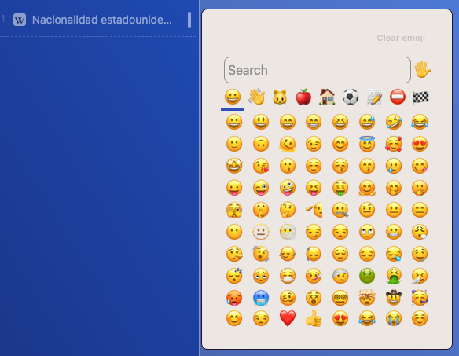
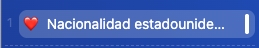
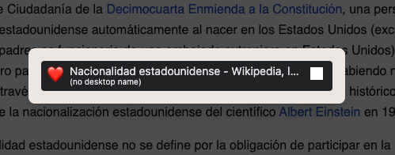
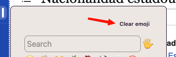

import FeatureAccess from '../../../../components/FeatureAccess.astro'

Un emoji es un **marcador** que puedes poner en una pestaña para distinguirla de las demás. Ocupa el lugar del favicon, así que el emoji es lo que verás en la barra lateral.

## Poner un emoji

<FeatureAccess entity="poner un emoji en una pestaña" contextMenu="contextTab.setEmoji" />

Abre el **menú contextual** de una pestaña y haz clic en **Establecer emoji...**. Se abre un panel al lado de la pestaña con una lista de emojis que puedes recorrer por categorías o buscar por nombre.

Haz clic en el emoji que quieras y se asigna a la pestaña. El panel se cierra solo.

## Ver el emoji de una pestaña

Cada pestaña muestra su emoji en la barra lateral, donde estaría el favicon.

El emoji también aparece en el selector de pestañas, así que puedes localizar una pestaña sin leer la lista entera.

## Quitar el emoji

Abre otra vez el panel de **Establecer emoji...** y haz clic en **Quitar emoji**. La pestaña vuelve a mostrar su favicon.

:::note
El botón **Quitar emoji** solo está activo cuando la pestaña ya tiene un emoji.
:::

## Emojis y sesiones

El emoji se guarda con la sesión, así que vuelve cuando la restauras. Si duplicas una pestaña, la copia recibe el mismo emoji.

:::note
Los emojis se dibujan con la fuente de emojis de tu sistema operativo. Pueden verse distintos según el equipo que uses.
:::
