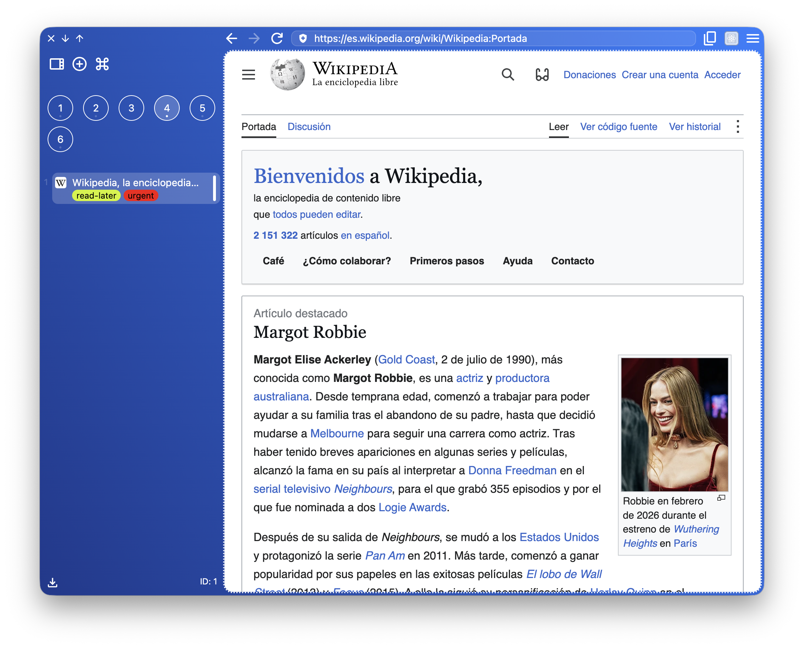
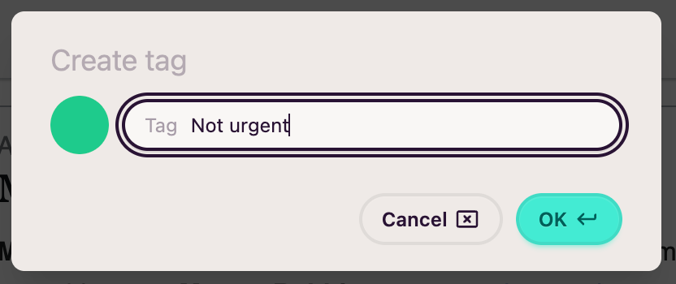
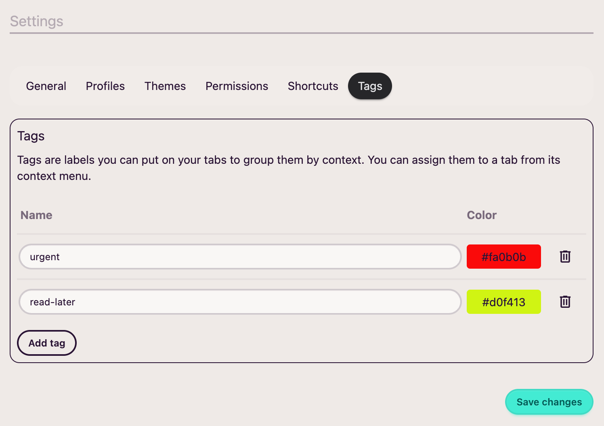

import FeatureAccess from '../../../../components/FeatureAccess.astro'

Las etiquetas son **etiquetas** que puedes poner en tus pestañas para agruparlas por contexto. Una etiqueta tiene un nombre y un color, y una pestaña puede tener todas las etiquetas que necesites.

## Crear una etiqueta

<FeatureAccess entity="crear una etiqueta" contextMenu="contextTab.createTag" />

Abre el **menú contextual** de una pestaña y ve a **Etiquetas → Crear etiqueta**. Puedes elegir el color y escribir el nombre de la etiqueta.

El nombre que escribas se convierte en un nombre corto, formado por letras minúsculas y guiones, de hasta diez caracteres. Necesita al menos tres caracteres.

La etiqueta se crea y se asigna a la pestaña desde la que abriste el menú.

## Ver las etiquetas de una pestaña

Cada pestaña muestra sus etiquetas en la barra lateral, debajo de su título. Cada una es una etiqueta con el nombre del tag sobre el color del tag.

## Asignar y quitar una etiqueta

Abre el **menú contextual** de una pestaña y ve a **Etiquetas**. Ahí se listan todas las etiquetas que tienes, y las que la pestaña ya tiene aparecen marcadas.

<FeatureAccess entity="asignar una etiqueta a una pestaña" contextMenu="contextTab.tags" />

Haz clic en una de ellas para asignar la etiqueta a la pestaña, o para quitarla si la pestaña ya la tenía.

## Gestionar tus etiquetas

Puedes añadir, renombrar, cambiar el color y eliminar tus etiquetas desde el apartado **Etiquetas** de la configuración.

Desde ese apartado puedes:

* Añadir una etiqueta nueva.
* Cambiar el nombre de una etiqueta. El nombre se convierte en un nombre corto, igual que cuando creas una etiqueta.
* Cambiar el color de una etiqueta.
* Eliminar una etiqueta.

:::note
Eliminar una etiqueta también la quita de todas las pestañas que la tenían.
:::
