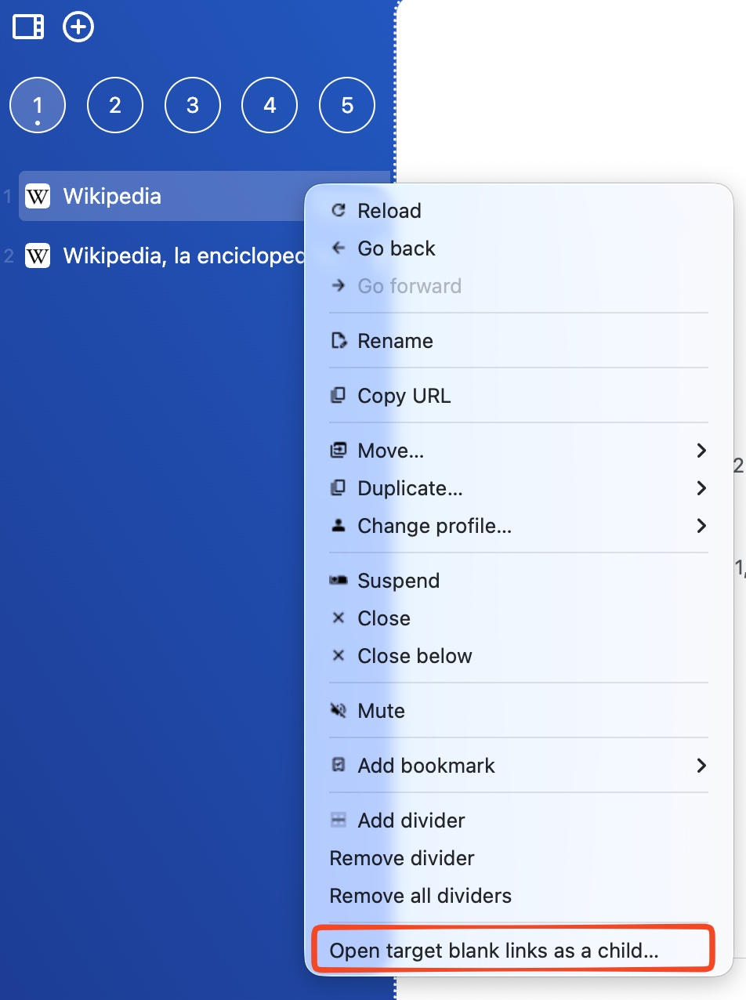
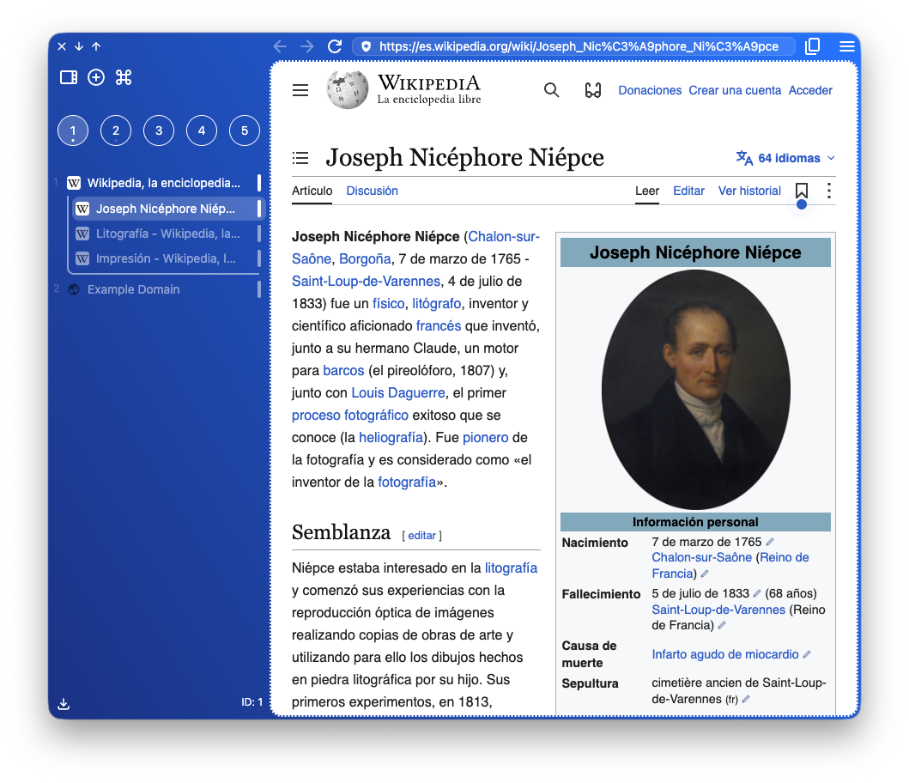
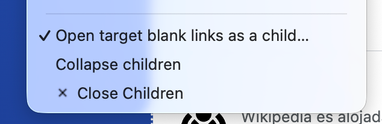
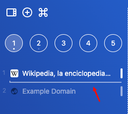

import { getMenuItems } from '../../../../scripts/i18n';
export const menu = await getMenuItems('en', 'contextTab.openTargetBlankAsChild')
export const move = await getMenuItems('en', 'contextTab.move')

Imagine the following scenario.

In the *sidebar* you have three tabs: Jira, Tab 2, Tab 3. Jira opens all tickets as `target="_blank"`. This means new tabs will be created at the end, after Tab 3.

This is very inconvenient because the tabs end up disorganized, and that's why the following feature exists.

Open the context menu and select the option **{menu[0]}**.

From now on, all websites that open from this tab will become children.

This lets you move the parent up or down while keeping the children linked.

You can also use the context menu to close all children or collapse them.

When collapsed, you'll see a bracket in the sidebar, drawn around the children:

The bracket is made of two lines: a vertical one on the left and a horizontal one at the bottom, joined by a rounded corner. Click any part of it to expand the children again without going through the context menu. When the children are expanded the same bracket surrounds them, and clicking it collapses them back.

Hovering the bracket makes it fully opaque and slightly thicker, so the action is visible only when you need it.

If you want to detach a child from its parent and turn it into a regular top-level tab container, open the context menu on the child, choose **{move[0]}** and then *Move to top level*. The child keeps its own tabs and any children it has.

You can also drag a tab and drop it onto a tab with this option enabled to turn it into one of its children. See [move a tab](/tabs/move/#drag-and-drop).
