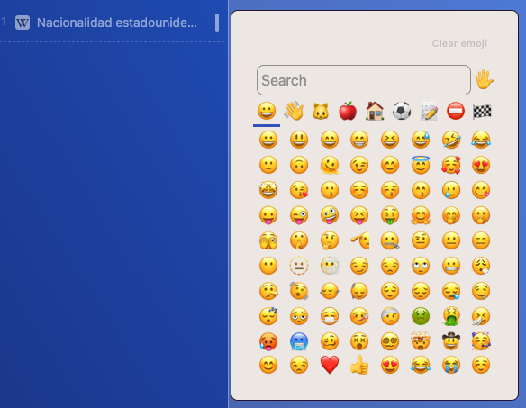
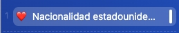
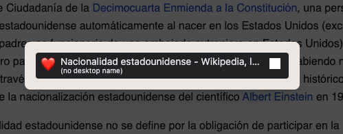
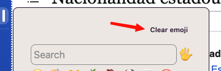

import FeatureAccess from '../../../components/FeatureAccess.astro'

An emoji is a **marker** you can put on a tab to tell it apart from the others. It takes the place of the favicon, so the emoji is what you'll see in the sidebar.

## Setting an emoji

<FeatureAccess entity="set an emoji on a tab" contextMenu="contextTab.setEmoji" />

Open the **context menu** of a tab and click **Set emoji...**. A panel opens next to the tab with a list of emojis you can browse by category or search by name.

Click the emoji you want and it's assigned to the tab. The panel closes on its own.

## Seeing the emoji of a tab

Every tab shows its emoji in the sidebar, where the favicon would be.

The emoji also shows up in the tab switcher, so you can spot a tab without reading the whole list.

## Removing the emoji

Open the **Set emoji...** panel again and click **Clear emoji**. The tab goes back to showing its favicon.

:::note
The **Clear emoji** button is only enabled when the tab already has an emoji.
:::

## Emojis and sessions

The emoji is saved with the session, so it comes back when you restore it. If you duplicate a tab, the copy gets the same emoji.

:::note
Emojis are rendered with the emoji font of your operating system. They can look different depending on the machine you use.
:::
