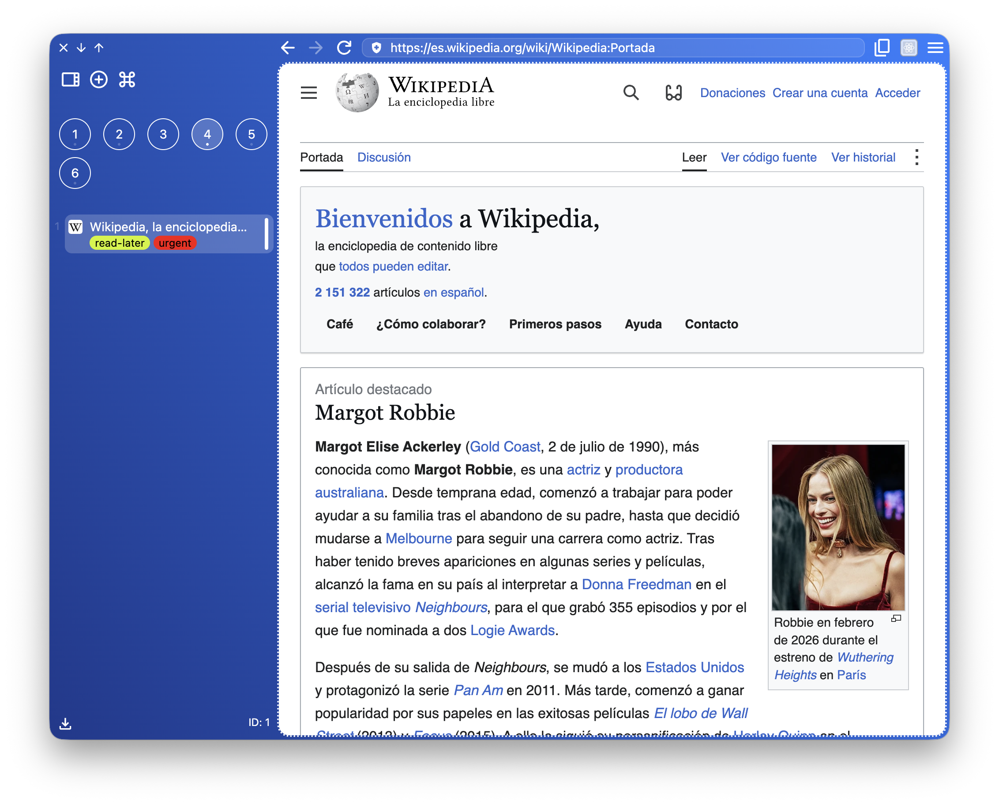
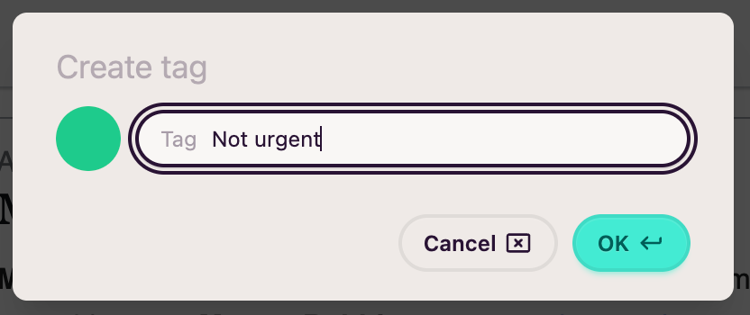
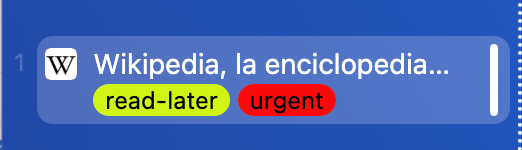
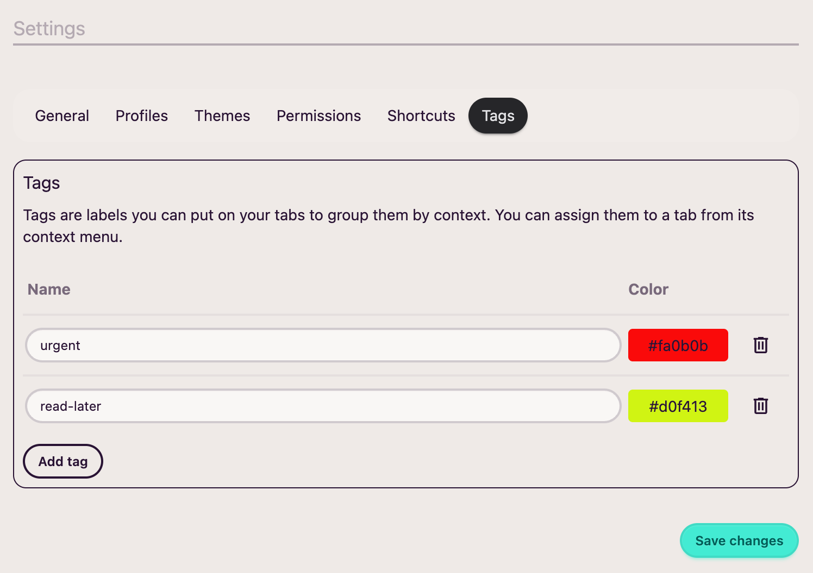

import FeatureAccess from '../../../components/FeatureAccess.astro'

Tags are **labels** you can put on your tabs to group them by context. A tag has a name and a color, and a tab can have as many tags as you need.

## Creating a tag

<FeatureAccess entity="create a tag" contextMenu="contextTab.createTag" />

Open the **context menu** of a tab and go to **Tags → Create tag**. You can pick the color and write the name of the tag.

The name you write is turned into a short name, made of lowercase letters and dashes, of up to ten characters. It needs at least three characters.

The tag is created and assigned to the tab you opened the menu from.

## Seeing the tags of a tab

Every tab shows its tags in the sidebar, under its title. Each one is a chip with the name of the tag on the color of the tag.

## Assigning and removing a tag

Open the **context menu** of a tab and go to **Tags**. Every tag you have is listed there, and the ones the tab already has are marked.

<FeatureAccess entity="assign a tag to a tab" contextMenu="contextTab.tags" />

Click one of them to assign the tag to the tab, or to remove it if the tab already has it.

## Managing your tags

You can add, rename, recolor and delete your tags from the **Tags** section of the settings.

From that section you can:

* Add a new tag.
* Change the name of a tag. The name is turned into a short name, the same way it is when you create a tag.
* Change the color of a tag.
* Delete a tag.

:::note
Deleting a tag also removes it from every tab that had it.
:::
