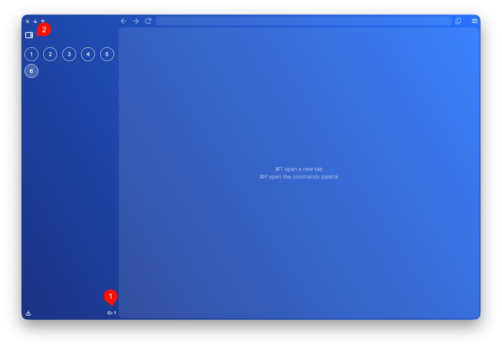
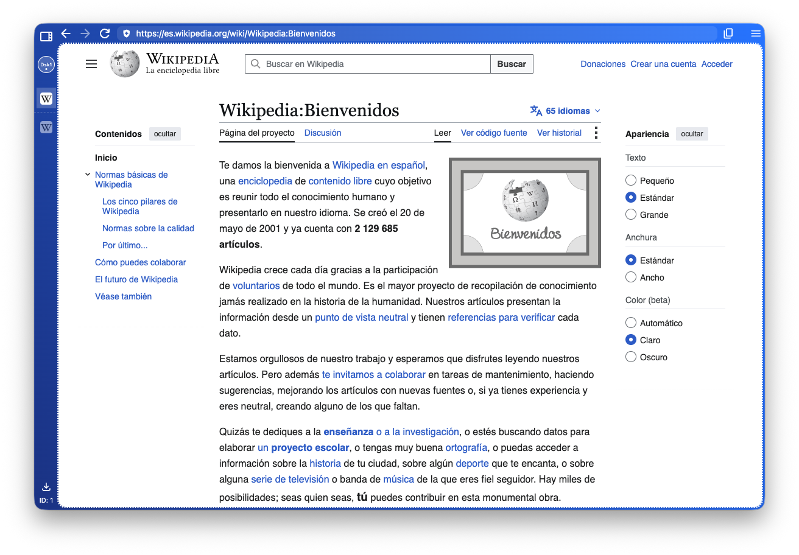
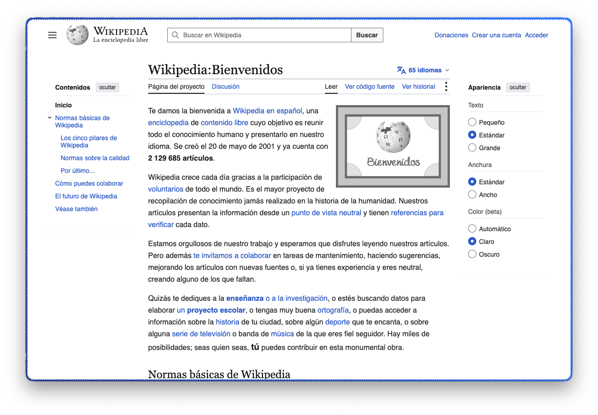

import FeatureAccess from '../../../components/FeatureAccess.astro'

A window is identified by a number (1). This way, when you move a tab to another window, you can identify it better.

## Collapse left panel (sidebar)

<FeatureAccess entity="collapse the left panel" shortcut="toggleSidebar" command="toggleSidebar"/>

You can also do it by clicking the collapse button (2).

The panel and the website will resize with a smooth transition.

## Maximize area

<FeatureAccess entity="maximize a website" shortcut="toggleMaximizeArea" command="toggleMaximizeArea"/>

It's useful when you want the website to take up all the available space.

:::note
These transitions follow the reduced motion preference of your operating system. If you have it turned on, the panel and the website will resize instantly.
:::
